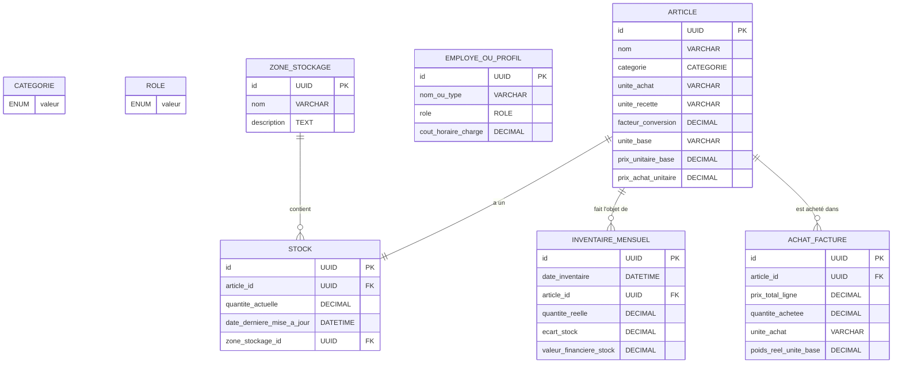

# Cannelle et Piment — Plateforme SaaS B2B de Contrôle de Gestion Traiteur

> **Showroom Portfolio Déployable sur Vercel (Zéro-Configuration)**  
> Application web B2B de contrôle de gestion, d'analyse des marges contributives et de chiffrage de rentabilité événementielle (TDABC).

## 🚀 Déploiement Vercel 100% Zéro-Configuration
- **Zéro dépendance de base de données** : Le showroom fonctionne en pur front-end haute performance et Node.js serverless.
- **Zéro variable d'environnement (.env)** : Déploiement immédiat en One-Click sur Vercel.
- **CRUD interactif en Local State** : Toutes les opérations (création/modification de recettes, mercuriale d'ingrédients, chiffrage de devis) sont simulées et persistées dans le navigateur du visiteur avec possibilité de réinitialiser le jeu d'essai en un clic.

### Commandes Locales
```bash
# 1. Test du build (validation Vercel)
npm run build

# 2. Démarrage de l'application (http://localhost:3000)
npm start
```


## 📂 Structure du Projet

Ce dossier contient plusieurs implémentations afin de s'adapter parfaitement à votre stack technique :

```text
Projet cannelle et piment/
├── README.md                  # Documentation globale (ce fichier)
├── schema.sql                 # Script SQL pur avec triggers PostgreSQL
├── schema.prisma              # Schéma Prisma PostgreSQL de référence
├── mongoose_models/           # Modèles NoSQL pour MongoDB et Mongoose
│   ├── Categorie.js
│   ├── Article.js
│   ├── Stock.js
│   ├── InventaireMensuel.js
│   ├── Role.js
│   ├── EmployeOuProfil.js
│   ├── ZoneStockage.js        # Modèle de zone de stockage
│   ├── AchatFacture.js        # Modèle d'achat facturé avec hook de calcul
│   ├── CategoriePlat.js       # Modèle de catégories de plats
│   ├── FicheTechnique.js      # Modèle de fiche technique (recette + lignes)
│   ├── EvenementDevis.js      # Modèle d'événement devis (devis + lignes de portions)
│   ├── TempsTravailEvenement.js # Modèle NoSQL de temps de travail direct
│   ├── FraisExterne.js        # Modèle NoSQL de frais externe direct
│   ├── AnalyseRentabilite.js  # Modèle NoSQL d'analyse de rentabilité consolidée
│   └── ExplicationCalcul.js   # Modèle NoSQL de traçabilité et audit des calculs
└── express_api/               # API REST Express.js fonctionnelle (SQLite)
    ├── package.json
    ├── prisma/
    │   └── schema.prisma      # Schéma Prisma SQLite de test
    ├── src/
    │   ├── server.js          # Serveur Express principal
    │   ├── routes/
    │   │   ├── articles.js    # Routes CRUD Articles avec unité base
    │   │   ├── stocks.js      # Routes CRUD Stocks reliés aux zones
    │   │   ├── inventaires.js # Routes d'inventaires
    │   │   ├── employes.js    # Routes de main d'œuvre
    │   │   ├── zones.js       # Routes CRUD des zones de stockage
    │   │   ├── achats.js      # Routes d'achats avec calcul du prix unitaire base
    │   │   ├── recettes.js    # Routes CRUD Recettes (Fiches techniques) avec coût analytique
    │   │   ├── devis.js       # Routes CRUD Devis avec chiffrage global analytique
    │   │   ├── temps.js       # Routes de suivi de main d'œuvre directe
    │   │   ├── frais.js       # Routes d'allocation de frais externes
    │   │   ├── rentabilite.js # Routes d'analyse de rentabilité consolidée graphiques
    │   │   └── explications.js # Routes de traçabilité et audit des calculs
    │   └── utils/
    │       └── calculs.js
    └── .env.example
```

---

## 📊 Modèle de Données (Schéma Conceptuel)

Le schéma repose sur 4 entités principales reliées de façon logique :



### 1. Table `Categorie` (Énumération stricte)
Représente les familles de produits du traiteur :
* `Produits laitiers`
* `Viandes et Volailles`
* `Poissons et Crustacés`
* `Épicerie et Sec`
* `Fruits et Légumes`
* `Boissons`
* `Spiritueux`

### 2. Table `Article`
Contient les fiches techniques des ingrédients/produits achetés.
* **Facteur_Conversion** : Permet de faire la passerelle entre l'unité d'achat du fournisseur et l'unité utilisée dans les recettes de cuisine.
  * *Exemple* : Vous achetez de la crème fraîche en briques d'un litre (`Unite_Achat = "Caisse" de 6L` soit `6` unités) et vous l'utilisez en grammes (`Unite_Recette = "Gramme"`).
  * Le facteur de conversion permet de convertir la quantité achetée en unité utilisable pour le calcul des stocks et coûts de revient.
* **Prix_Achat_Unitaire** : Prix payé par unité d'achat.

### 3. Table `Stock`
Représente l'état théorique en temps réel des stocks.
* Liée par une relation **1-à-1** (ou 1-à-N si multi-dépôts) avec la table `Article`.
* Contient la `Quantite_Actuelle` théorique (mise à jour lors des achats ou des ventes/recettes).

### 4. Table `Inventaire_Mensuel`
L'inventaire physique effectué chaque mois par l'équipe en cuisine.
* **Logique Métier Intégrée** :
  * `Ecart_Stock` = `Quantite_Reelle` (physique) - `Quantite_Actuelle` (théorique dans `Stock`).
  * `Valeur_Financiere_Stock` = `Quantite_Reelle` (physique) * `Article.Prix_Achat_Unitaire`.
* **Ajustement Automatique** : Lors de la soumission de l'inventaire, le stock théorique (`Stock.Quantite_Actuelle`) est automatiquement réaligné sur la `Quantite_Reelle` observée.

### 5. Table `Employe_ou_Profil` (Main d'œuvre)
Sert à la comptabilité analytique de la main d'œuvre en cuisine et en salle.
* **Role** : Énumération stricte : `[Commis, Serveur, Administratif, Livreur]`.
* **Cout_Horaire_Charge** : Coût horaire réel de l'employé incluant toutes les charges de l'entreprise.

### 6. Table `Zone_Stockage`
Espaces d'entreposage physique au sein de l'établissement du traiteur.
* *Exemples* : "Chambre froide positive", "Congélateur", "Réserve sèche".
* Permet d'organiser les stocks physiquement. Chaque fiche de `Stock` est affectée à une zone spécifique.

### 7. Table `Achat_Facture`
Facturation fournisseur enregistrant les achats d'ingrédients.
* **Règle du Dernier Prix d'Achat (Last Purchase Price)** : Lors de l'enregistrement de chaque achat, un **Trigger SQL automatique** (ou un **Hook de modèle applicatif**) calcule le coût unitaire réel ramené à l'unité de base (`Prix_Total_Ligne` / `Poids_Reel_Unite_Base`) et met automatiquement à jour le champ `prix_unitaire_base` de l'Article concerné.

---

## 🚀 Comment démarrer l'API Express de test ?

Le dossier `express_api/` contient une API fonctionnelle prête à l'emploi avec une base de données **SQLite** locale pour simplifier le développement et les tests.

### Prérequis
* [Node.js](https://nodejs.org/) (version 18+)
* [npm](https://www.npmjs.com/)

### Étapes d'installation
1. Accédez au dossier de l'API :
   ```bash
   cd "express_api"
   ```
2. Installez les dépendances :
   ```bash
   npm install
   ```
3. Créez votre fichier d'environnement `.env` :
   ```bash
   copy .env.example .env
   ```
4. Initialisez la base de données SQLite et générez le client Prisma :
   ```bash
   npx prisma db push
   ```
5. Lancez le serveur de développement :
   ```bash
   npm run dev
   ```
   L'API sera disponible sur `http://localhost:3000`.

---

## 📡 Documentation des Endpoints API

### Articles (`/api/articles`)
* `GET /api/articles` : Liste de tous les articles.
* `POST /api/articles` : Ajouter un article.
* `GET /api/articles/:id` : Détails d'un article.
* `PUT /api/articles/:id` : Modifier un article.
* `DELETE /api/articles/:id` : Supprimer un article.

### Stocks (`/api/stocks`)
* `GET /api/stocks` : Consulter le stock théorique de tous les articles.
* `PUT /api/stocks/:id` : Mettre à jour ou ajuster manuellement la quantité d'un stock.

### Inventaires (`/api/inventaires`)
* `GET /api/inventaires` : Consulter tous les inventaires réalisés.
* `POST /api/inventaires` : Soumettre un nouvel inventaire mensuel.
  * **Payload requis** :
    ```json
    {
      "articleId": "id-de-l-article",
      "quantiteReelle": 45.5,
      "dateInventaire": "2026-05-31T23:59:59.000Z"
    }
    ```
  * *Comportement* : L'API calcule automatiquement l'écart de stock et la valeur financière, enregistre l'inventaire, et met à jour le stock actuel de l'article avec la `quantiteReelle`.

### Employés & Profils de Main d'œuvre (`/api/employes`)
* `GET /api/employes` : Liste de tous les profils d'employés (filtre optionnel `?role=COMMIS` disponible).
* `POST /api/employes` : Ajouter un employé ou un type de profil.
  * **Payload requis** :
    ```json
    {
      "nomOuType": "Jean Dupont",
      "role": "Commis",
      "coutHoraireCharge": 24.50
    }
    ```
* `GET /api/employes/:id` : Détails d'un employé.
* `PUT /api/employes/:id` : Modifier un profil (nom, rôle, coût horaire chargé).
* `DELETE /api/employes/:id` : Supprimer un profil.

### Zones de Stockage (`/api/zones`)
* `GET /api/zones` : Liste de toutes les zones de stockage physiques.
* `POST /api/zones` : Créer une zone de stockage.
  * **Payload requis** :
    ```json
    {
      "nom": "Chambre froide positive 🌶️",
      "description": "Stockage des produits laitiers et légumes frais"
    }
    ```
* `GET /api/zones/:id` : Détails d'une zone avec tous les stocks physiques qui y sont situés.
* `PUT /api/zones/:id` : Modifier le nom ou la description d'une zone.
* `DELETE /api/zones/:id` : Supprimer une zone (détache automatiquement les stocks en mettant leur zone à `null` sans les supprimer).

### Achats Facturés (`/api/achats`)
* `GET /api/achats` : Historique de tous les achats facturés.
* `POST /api/achats` : Enregistrer un nouvel achat facturé fournisseur.
  * **Payload requis** :
    ```json
    {
      "articleId": "id-de-l-article-dans-la-base",
      "prixTotalLigne": 120.00,
      "quantiteAchetee": 10,
      "uniteAchat": "Caisse",
      "poidsReelUniteBase": 5.0
    }
    ```
  * *Comportement transactionnel (Last Purchase Price)* : L'API insère la facture d'achat, calcule automatiquement le coût à l'unité de base (ex. 120 € / 5 Kg = 24 €/Kg) et met instantanément à jour le `prixUnitaireBase` de la fiche Article en base de données.

### Fiches Techniques & Recettes (`/api/recettes`)
* `GET /api/recettes` : Liste toutes les recettes avec leur **coût des matières premières** recalculé dynamiquement à partir des prix unitaires de base actuels des ingrédients.
* `POST /api/recettes` : Créer une fiche technique avec ses ingrédients et proportions requises.
  * **Payload requis** :
    ```json
    {
      "nomRecette": "Mignon de Porc Sauce Moutarde 🌿",
      "categoriePlat": "Plat",
      "lignes": [
        {
          "articleId": "id-de-l-ingredient-porc",
          "quantiteNecessaireUniteBase": 0.200
        },
        {
          "articleId": "id-de-l-ingredient-moutarde",
          "quantiteNecessaireUniteBase": 0.030
        }
      ]
    }
    ```
* `GET /api/recettes/:id` : Consulter une fiche technique de recette avec son coût d'ingrédients total analytique.
* `DELETE /api/recettes/:id` : Supprimer une fiche technique (et ses lignes associées en cascade).

### Devis Événementiels (`/api/devis`)
* `GET /api/devis` : Consulter tous les événements devis avec leur **valorisation financière globale** (coût total théorique d'achat matière de l'événement).
* `POST /api/devis` : Créer un devis d'événement client et y associer les recettes avec le nombre de portions demandées.
  * **Payload requis** :
    ```json
    {
      "nomClient": "Société Alpha Events",
      "dateEvenement": "2026-06-15T19:00:00.000Z",
      "devisLignes": [
        {
          "ficheTechniqueId": "id-de-la-recette-mignon-de-porc",
          "nombrePortions": 150
        }
      ]
    }
    ```
* `GET /api/devis/:id` : Consulter la décomposition analytique complète d'un devis client. Celle-ci intègre :
  * La liste des recettes de l'événement et leur nombre de portions.
  * Les heures de cuisine enregistrées (`mainDeuvreDirecte`) et leur coût réel.
  * La liste des `fraisExternesDirects`.
  * La valorisation synthétique :
    * `coutTotalMatiereDevis` (coût brut ingrédients).
    * `coutTotalMainOeuvreDevis` (coût réel cumulé du personnel).
    * `coutTotalFraisExterneDevis` (frais annexes logistiques).
    * `coutAnalytiqueTotalDevis` (grand total des coûts directs).
* `DELETE /api/devis/:id` : Supprimer un devis (les lignes associées, temps et frais sont supprimés en cascade).

### Temps de Travail Direct Événementiel (`/api/temps`)
* `GET /api/temps` : Historique de tous les temps de travail imputés sur les devis.
* `POST /api/temps` : Imputer des heures de travail sur un devis d'événement.
  * **Payload requis** :
    ```json
    {
      "evenementDevisId": "id-du-devis-evenement-client",
      "employeId": "id-du-profil-employe-dans-la-base",
      "heuresEffectueesCuisine": 8.5
    }
    ```
  * *Comportement analytique automatique* : L'API récupère instantanément le coût horaire chargé du profil (`coutHoraireCharge`), effectue la multiplication (`heures * taux`) et enregistre le montant exact dans `coutTotalMainOeuvre` pour garantir la justesse comptable sans intervention manuelle.
* `DELETE /api/temps/:id` : Supprimer une imputation de temps.

### Frais Externes Directs (`/api/frais`)
* `GET /api/frais` : Liste de tous les frais externes affectés aux devis.
* `POST /api/frais` : Affecter un frais externe direct (vaisselle, camion, etc.) à un événement.
  * **Payload requis** :
    ```json
    {
      "evenementDevisId": "id-du-devis-evenement-client",
      "categorie": "Location vaisselle et nappage",
      "montantHT": 380.00
    }
    ```
* `DELETE /api/frais/:id` : Supprimer un enregistrement de frais externe.

### Analyse de Rentabilité Graphique (`/api/rentabilite`)
* `GET /api/rentabilite/:evenementDevisId` : Récupère la rentabilité consolidée complète d'un devis d'événement client.
  * **Simulation de Simulation interactive** : Permet de passer optionnellement dans l'URL les paramètres `quotePartFraisFixes` (Frais fixes) et `coutPerteAlimentaire` (Gaspillage estimé) (ex: `?quotePartFraisFixes=150&coutPerteAlimentaire=60`). Si ces paramètres ne sont pas fournis, l'API recharge intelligemment les valeurs précédemment sauvées en base pour cet événement afin d'éviter toute perte de saisie !
  * **Payload Premium Visual-Ready** : Les données retournées sont formatées de façon optimale pour être directement branchées sur des bibliothèques de graphiques (ex: Chart.js, Recharts, Nivo) en camembert ou en barres :
    ```json
    {
      "devisId": "uuid-du-devis",
      "nomClient": "Société Alpha Events",
      "dateEvenement": "2026-06-15T19:00:00.000Z",
      "prixVenteHT": 1500.00,
      "totalConvives": 150,
      "indicateurs": {
        "tauxMargeBrutePourcent": 38.25,
        "tauxMargeNettePourcent": 24.25,
        "coefficientMultiplicateur": 1.32,
        "coutRevientParConvive": 7.58,
        "prixVenteParConvive": 10.00,
        "rentable": true
      },
      "consolidationPersistee": {
        "id": "uuid-analyse-rentabilite",
        "evenementDevisId": "uuid-du-devis",
        "totalCoutMatiere": 480.00,
        "totalMainOeuvreDirecte": 240.00,
        "totalFraisExternes": 206.25,
        "margeBruteHT": 573.75,
        "quotePartFraisFixes": 150.00,
        "coutPerteAlimentaire": 60.00,
        "margeNetteHT": 363.75,
        "coutRevientParConvive": 7.58
      },
      "graphiqueChiffreAffaires": [
        { "id": "matiere", "label": "Matières Premières (Ingrédients)", "value": 480.00, "percentage": 32.0, "color": "#FF6384" },
        { "id": "main_oeuvre", "label": "Main d'œuvre Directe", "value": 240.00, "percentage": 16.0, "color": "#36A2EB" },
        { "id": "frais_externes", "label": "Frais Externes Directs", "value": 206.25, "percentage": 13.8, "color": "#FFCE56" },
        { "id": "frais_fixes", "label": "Frais Fixes Allocations", "value": 150.00, "percentage": 10.0, "color": "#9966FF" },
        { "id": "perte_alimentaire", "label": "Pertes/Gaspillage Alimentaire", "value": 60.00, "percentage": 4.0, "color": "#C9CBCF" },
        { "id": "marge_nette", "label": "Marge Nette HT", "value": 363.75, "percentage": 24.3, "color": "#4BC0C0" }
      ],
      "graphiqueRepartionCoutsGlobaux": [
        { "id": "matiere", "label": "Matières Premières", "value": 480.00, "percentage": 42.2, "color": "#FF6384" },
        { "id": "main_oeuvre", "label": "Main d'œuvre", "value": 240.00, "percentage": 21.1, "color": "#36A2EB" },
        { "id": "frais_externes", "label": "Frais Directs", "value": 206.25, "percentage": 18.1, "color": "#FFCE56" },
        { "id": "frais_fixes", "label": "Frais Fixes", "value": 150.00, "percentage": 13.2, "color": "#9966FF" },
        { "id": "perte_alimentaire", "label": "Pertes Alimentaires", "value": 60.00, "percentage": 5.3, "color": "#C9CBCF" }
      ]
    }
    ```

### Traçabilité & Audit des Calculs (`/api/explications`)
* `GET /api/explications` : Récupère l'ensemble des historiques de traçabilité des calculs analytiques.
  * **Filtre par entité** : Permet de requêter directement l'historique d'un devis via le paramètre de requête `?entiteConcernee=Devis #<ID_DU_DEVIS>`.
  * **Payload d'Audit** : Idéal pour l'affichage d'un onglet **'Détails & Audit'** sur le Front-end :
    ```json
    [
      {
        "id": "uuid-explication-calcul",
        "entiteConcernee": "Devis #uuid-du-devis",
        "nomIndicateur": "Marge Nette HT",
        "formuleLitterale": "Marge Nette HT = Marge Brute HT - Quote-part Frais Fixes - Coût Perte Alimentaire",
        "variablesUtilisees": {
          "margeBruteHT": 573.75,
          "quotePartFraisFixes": 150.00,
          "coutPerteAlimentaire": 60.00,
          "margeNetteHT": 363.75
        },
        "creeLe": "2026-05-17T14:30:00.000Z",
        "misAJourLe": "2026-05-17T14:30:00.000Z"
      }
    ]
    ```

### Exportation de Données Analytiques (`/api/export`)
* **Format CSV** :
  * `GET /api/export/csv/stocks` : Télécharge l'état des stocks réels avec zones et unités au format CSV.
  * `GET /api/export/csv/achats` : Télécharge l'historique des factures d'achats avec volumes et coûts en CSV.
  * `GET /api/export/csv/devis` : Télécharge l'historique analytique complet de rentabilité des devis en CSV.
* **Format Excel** :
  * `GET /api/export/excel/stocks` : Télécharge l'état des stocks au format Excel (.xls compatible).
  * `GET /api/export/excel/achats` : Télécharge l'historique d'achats au format Excel (.xls compatible).
  * `GET /api/export/excel/devis` : Télécharge le tableau de rentabilité complet des devis au format Excel (.xls compatible) avec mise en valeur visuelle intelligente des marges positives/négatives.

### Règles Comptables Globales de Rentabilité
1. **Quote-Part Frais Fixes** : Calculée automatiquement à partir de la formule d'allocation :
   $$\text{Frais Fixes Événement} = \frac{\text{Charges Fixes Annuelles (12 000 €)}}{\text{Moyenne Annuelle Événements (50)}}$$
   Ce qui donne par défaut **240.00 €** d'overhead fixe par événement.
2. **Coût Perte Alimentaire Forfaitaire** : Appliqué d'office d'après la formule :
   $$\text{Perte Alimentaire} = \text{Coût Matières Premières} \times \left( \frac{\text{Taux Perte Forfaitaire (5\%)}}{100} \right)$$
   Ces règles sont automatiquement documentées de manière auditable dans la table `ExplicationCalcul`.
